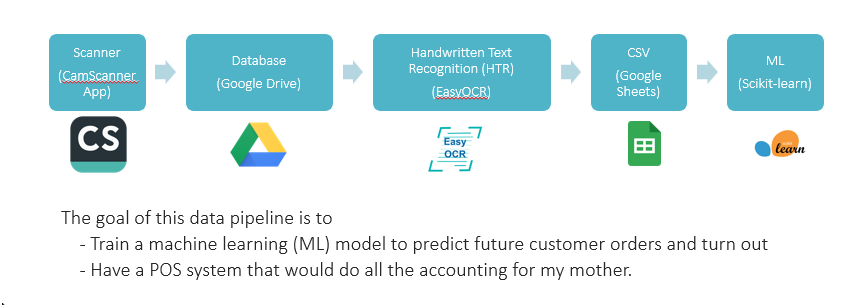

# Restaurant Bill OCR and Forecasting Project

This project is designed to process restaurant receipts and bills using OCR, extract itemized orders, organize the data, and apply machine learning models to predict future customer orders or demand.



**IMPORTANT**
- Parts of this project is not shown to protect proprietary information from the public. 


## Goal

The end-to-end pipeline is intended to:
- scan and capture receipt images
- extract text from restaurant bills using OCR
- parse menu items, quantities, prices, and totals
- store cleaned data in Google Drive / Google Sheets
- train ML models on the extracted order data
- support forecasting and business insight for restaurant operations

## Project flow

1. Scanner app captures receipt or bill images
2. Images are stored in a database or cloud storage
3. OCR extracts handwritten or printed text
4. Structured order data is exported to CSV / Google Sheets
5. ML models analyze historical order patterns

## Repository structure

- `Google/` - Google Drive API integration and file-processing scripts
- `Google_Sheets/` - Google Sheets export and data handling examples
- `OCR/` - OCR experiments and notebook work
- `.env` - local credentials and IDs (not committed)
- `.env.example` - template for environment variables

## Setup

1. Create a virtual environment.
2. Install required Python packages.
3. Copy `.env.example` to `.env` and fill in your values.

Example environment variables:

```env
GOOGLE_API_KEY=your_google_api_key_here
GOOGLE_CLIENT_ID=your_google_client_id_here
GOOGLE_CLIENT_SECRET=your_google_client_secret_here
GOOGLE_CLIENT_SECRET_FILE=Google/credentials.json
GOOGLE_DEVELOPER_KEY=your_google_developer_key_here
GOOGLE_SHEET_ID=your_sheet_id_here
GOOGLE_DRIVE_FILE_ID=your_drive_file_id_here
OCR_API_KEY=your_ocr_api_key_here
```

## Important notes

- Keep all secrets, IDs, and sensitive configuration in `.env`.
- Do not commit `.env` to version control.
- `.env.example` is provided as a safe template.

## Future work

Discontinued 
